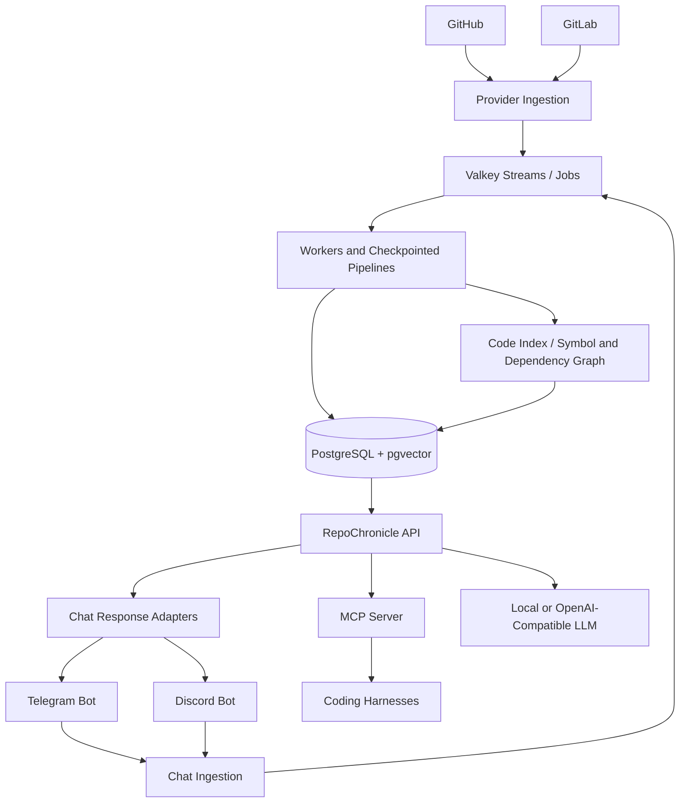

# RepoChronicle

**Open-source project intelligence for code, Git activity, and team conversations.**

RepoChronicle builds a continuously updated, evidence-backed knowledge layer across repositories and team discussions. It is designed for self-hosting, multi-project use, read-only source access, MCP clients, and chat platforms.

> **Project status: foundation scaffold.** This repository contains the architecture, contracts, phased roadmap, local development stack, CI workflows, and an executable service skeleton. It is not yet a finished project-intelligence product. Features marked `planned` in the roadmap must not be represented as implemented.

## Why RepoChronicle?

- **Bootstrap once, then update incrementally.** When a repository is first connected, RepoChronicle performs a complete scan pinned to a known commit. After the initial scan, webhooks and reconciliation jobs process changes since recorded checkpoints.
- **One shared brain, many interfaces.** A central API and MCP server serve coding harnesses; chat connectors provide the same grounded knowledge to Telegram and Discord.
- **Evidence before confidence.** Answers should cite repository, commit, file/line, activity event, or message links. The system must disclose stale indexes and missing access rather than guessing.
- **Bounded context.** Source data lives in durable stores. Each question retrieves a small, ranked evidence pack under an explicit context budget.
- **Pluggable AI.** Local embedding models and OpenAI-compatible chat/embedding APIs are provider adapters. Fine-tuning is optional, evidence-driven, and never required for basic operation.
- **Self-hosted by default.** Core services run through Docker Compose. The project does not require a hosted SaaS control plane.

## Current implementation status

| Area | Status in this starter |
|---|---|
| Architecture, roadmap, ADRs, agent instructions | Included |
| Docker Compose, PostgreSQL + pgvector, Valkey | Included |
| API liveness/readiness endpoints | Included |
| Schema migration runner and initial schema | Included |
| Bootstrap state machine and tests | Included |
| Token-budgeted evidence selection and tests | Included |
| OpenAI-compatible chat and embedding adapters | Included; grounded answer/retrieval pipeline planned for F3/F4 |
| Local FastEmbed CPU embedding adapter | Included; end-to-end indexing pipeline planned for F3 |
| Optional fine-tuning job contract and dependency extra | Contract/extra included; execution planned for F6 |
| Replaceable CodeGraph/codesearch backend contract | Included; backend integration planned for F3 |
| Telegram/Discord message normalization contracts | Included |
| MCP server skeleton and status tool | Included |
| Full GitHub/GitLab onboarding and complete source scan | Planned phase F1 |
| Incremental Git/webhook ingestion | Planned phase F1/F2 |
| Production retrieval, embeddings pipeline, code graph | Planned phase F3 |
| Full Telegram/Discord event ingestion and replies | Planned phase F4/F5 |
| Fine-tuning execution/evaluation pipeline | Optional planned phase F6 |
| Multi-node production deployment | Planned phase F7 |

The starter deliberately distinguishes executable foundation code from implementation work left for an AI coding harness.

## Quick start

Requirements: Docker Engine with the Compose plugin, Git, and Python 3.12+ for local tests.

```bash
git clone https://github.com/vaheed/RepoChronicle.git
cd repochronicle
cp .env.example .env
docker compose up --build -d
docker compose ps
curl http://localhost:8080/health/live
curl http://localhost:8080/health/ready
curl http://localhost:8080/v1/status
```

The first build downloads container images and Python dependencies. It does **not** download LLM weights or embedding model weights automatically. Models are fetched only when a configured provider needs them; review each model's license and terms first.

The MCP endpoint is `http://127.0.0.1:8090/mcp`. The F0 server exposes only `repochronicle_status`; search/impact tools are added in later phases. Nanobot or another compatible harness can be used as an external client, but RepoChronicle does not vendor a second agent runtime.

API endpoints exposed by the default stack:

- `GET /health/live` — process liveness.
- `GET /health/ready` — readiness, including database and Valkey checks.
- `GET /v1/status` — current scaffold phase and feature status.

The initial stack is intentionally read-only with respect to connected repositories. Host ports bind to `127.0.0.1` by default. For remote team access, put the API/MCP behind an authenticated TLS reverse proxy and change the bind host deliberately; do not expose the scaffold's unauthenticated MCP endpoint directly to the public internet. Do not paste broad personal access tokens into repository URLs. Use secret management/environment variables and least-privilege credentials.

### Run tests locally

```bash
python -m venv .venv
source .venv/bin/activate
python -m pip install -U pip
pip install -e ".[dev]"
ruff check .
ruff format --check .
mypy src
pytest -q
```

Run Docker configuration validation:

```bash
docker compose config --quiet
```

### Optional local model runtime

Ollama is an optional local inference backend. It is not required to start the core stack.

```bash
docker compose --profile local-llm up -d
```

Configure an OpenAI-compatible endpoint in `.env`, for example:

```dotenv
RC_LLM_BASE_URL=http://ollama:11434/v1
RC_LLM_API_KEY=ollama
RC_LLM_MODEL=<model-you-have-pulled-and-reviewed>
```

Pull a model inside the Ollama container only after checking its model card and license. A permissive license on Ollama does not make every model served by it permissively licensed.

## First connection: intended onboarding behavior

Connecting an existing repository must trigger **initialization**, not pretend that a new source is already synchronized:

1. Register the organization/project/source and validate the read-only credential.
2. Resolve and record the target branch and an immutable target commit SHA.
3. Create a resumable bootstrap job with an idempotency key.
4. Clone/fetch the complete repository at that pinned SHA and perform a full first-pass scan.
5. Build source manifests, file metadata, symbols/dependencies, text chunks, and the configured embeddings.
6. Backfill provider-supported Git activity within configured permissions and date/rate-limit boundaries.
7. Verify that the indexed SHA is the recorded target SHA; if the branch moved, enqueue a delta job.
8. Persist per-stage checkpoints and mark the source `ready` only after required stages pass.
9. Process later changes through webhooks, with scheduled reconciliation as the recovery path for missed events.

The contracts and bootstrap state machine are included; end-to-end Git provider ingestion is a planned implementation phase. See [Bootstrap and Sync](docs/BOOTSTRAP_AND_SYNC.md).

Chat platform onboarding is different. The system starts observing new chat events after the bot/integration is installed and granted access. Telegram's Bot API does not provide a general historical group-message export for a normal bot, so a Telegram connector cannot promise to backfill old messages. Discord can support channel history backfill when permissions and message-content access allow it. See [Connectors](docs/CONNECTORS.md).

## Architectural overview



The diagram describes the target architecture, not a claim that all arrows are implemented in the foundation scaffold.

Read [Architecture](docs/ARCHITECTURE.md), [Roadmap](ROADMAP.md), [Code Intelligence Backends](docs/CODE_INTELLIGENCE_BACKENDS.md), and [Test Strategy](docs/TEST_STRATEGY.md) before starting implementation.

## License and dependency policy

RepoChronicle's own code is licensed under **Apache-2.0**. The repository intends to use permissively licensed dependencies and explicitly reviews all direct/transitive dependencies, container images, model weights, and generated artifacts.

- The license of a software library does not determine the license of a model's weights.
- OpenAI-compatible APIs are interfaces, not a guarantee of zero cost or any particular provider's data-retention policy.
- Optional training features must not bundle or silently download a model.
- A dependency with an unknown or disallowed license must be replaced or explicitly approved before merge.
- The CI license check is a guardrail, not a legal opinion. Review `docs/LICENSE_POLICY.md`.

## Project name

**RepoChronicle** is the proposed working name and GitHub repository slug. A web search did not surface an exact GitHub repository with this name at the time this starter was prepared, but this is not a trademark, company-name, domain, or username clearance.

## Contributing

Read [CONTRIBUTING.md](CONTRIBUTING.md), [agent.md](agent.md), and [AGENTS.md](AGENTS.md). Every phase must be independently testable and merged only when its acceptance criteria pass.

## Security

Report vulnerabilities privately when possible; see [SECURITY.md](SECURITY.md). Never commit credentials, source-code exports, chat exports, local model files, or production data.
